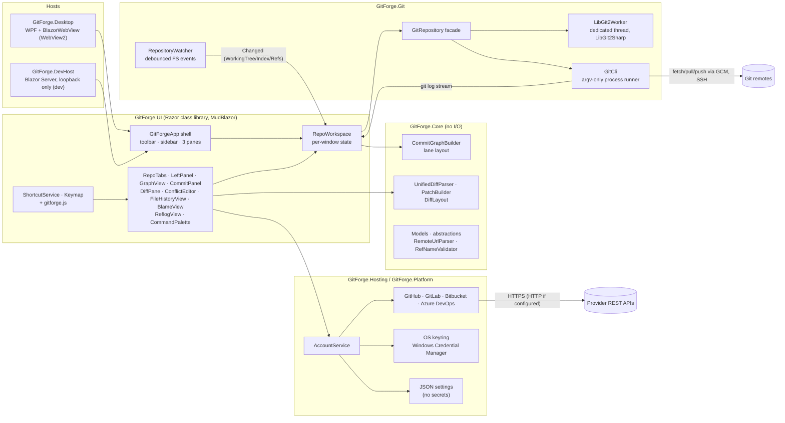

# GitForge Architecture

GitForge is a keyboard-first Git client built with C#/.NET 10, Blazor, and MudBlazor 9. It replaces Sourcetree for teams that need speed on large repositories, multi-account hosting integration, and a security posture suitable for regulated environments.

> **Stack note.** The original brief proposed a Rust UI and a custom GPU diff renderer. Per the project direction, the UI is Blazor + MudBlazor. Rendering speed comes from strict virtualization (only visible rows exist in the DOM) on top of WebView2/Chromium's GPU-composited rendering, not from a custom GPU pipeline.

## 1. Component diagram and data flow



**Read/write split (the key performance and fidelity decision):**

| Path | Engine | Why |
|---|---|---|
| Refs, branches, tags, stashes, submodules, status, commit details, reflog | **libgit2** (LibGit2Sharp) on one dedicated worker thread per repository | In-process, no process-spawn cost; serialized because `Repository` is not thread-safe. |
| History stream | **git CLI** `git log --date-order` streamed record-by-record | Core Git uses the commit-graph file; streaming paints the first rows before a 100k+ commit history finishes. |
| Diffs used for staging | **git CLI** `git diff --no-textconv` | Output is byte-identical to what `git apply` expects, so partial patches round-trip exactly (CRLF preserved). |
| Every write and all network I/O | **git CLI** | Honors hooks, commit signing, LFS filters, `.gitattributes`, credential helpers (Git Credential Manager), SSH agents, proxies, and custom CAs exactly as the command line does. |

**Refresh loop:** `RepositoryWatcher` classifies file-system events (working tree, index, refs, config), debounces them (350 ms), and raises `Changed`. `RepoWorkspace` coalesces overlapping refreshes, re-reads only what changed, and restreams history only when refs change. After any CLI write the libgit2 handle is invalidated so reads never see stale caches.

**Threading:** UI thread never touches git. libgit2 work runs on a per-repository actor thread; CLI work runs on the thread pool; results marshal back through `InvokeAsync`.

## 2. Project structure

```
GitSource/
├─ GitForge.slnx                 Solution (10 projects)
├─ Directory.Build.props         net10.0, nullable, analyzers (latest-recommended)
├─ Directory.Packages.props      Central package versions
├─ global.json                   SDK pin + Microsoft.Testing.Platform runner
├─ dotnet-tools.json             Pinned local tools (vpk, the Velopack packager)
├─ .github/workflows/            ci.yml (build + test), release.yml (tag → signed installers + update feed)
├─ src/
│  ├─ GitForge.Core/             Pure domain: Models/, Graph/, Diff/, Rebase/, Hosting/, Validation/, Abstractions/
│  ├─ GitForge.Git/              Cli/GitCli, Engine/ (LibGit2Worker, RepositoryWatcher, Reader, WriteOperations), GitRepository(+Factory)
│  ├─ GitForge.Platform/         Secrets/ (Windows Credential Manager, libsecret), Settings/ (atomic JSON)
│  ├─ GitForge.Hosting/          HostingProviderBase, Providers (GitHub/GitLab/Bitbucket/Azure DevOps), AccountService
│  ├─ GitForge.UI/               GitForgeApp.razor, Components/, Dialogs/, Services/, wwwroot/ (css, js)
│  ├─ GitForge.Desktop/          WPF host (WebView2), Program (Velopack hooks), VelopackUpdater, native folder picker, app.manifest
│  └─ GitForge.DevHost/          Loopback-only Blazor Server host for UI iteration and automated checks
├─ tests/
│  ├─ GitForge.Core.Tests/       Graph layout, diff parsing, patch building, URL parsing, validation
│  ├─ GitForge.Git.Tests/        Integration tests against real temporary repositories
│  └─ GitForge.UI.Tests/         Keymap, theme, highlighting, update feed and update-flow tests
└─ docs/                         ARCHITECTURE.md, ROADMAP.md, RELEASING.md
```

Dependency rule: `Core` depends on nothing. `Git`, `Platform`, and `Hosting` depend only on `Core`. `UI` composes them. Hosts depend only on `UI`. Adding a macOS/Linux host (Photino or MAUI) requires no changes below `UI`.

## 3. Core API and data models

All types live in `GitForge.Core` (`src/GitForge.Core`).

### Commit nodes and history

```csharp
record CommitInfo(string Sha, IReadOnlyList<string> ParentShas, string AuthorName,
                  string AuthorEmail, DateTimeOffset AuthorDate, string Subject);   // 100k+ kept in memory
record CommitDetails(CommitInfo Summary, string FullMessage, string CommitterName,
                     string CommitterEmail, DateTimeOffset CommitDate, IReadOnlyList<FileChange> Changes);
record HistoryQuery { bool AllRefs; string? StartRef; string? PathFilter; DateTimeOffset? Since, Until; int? MaxCount; }
record RefLabel(string Name, RefKind Kind, bool IsCurrent);                       // badges drawn on rows
```

### Graph layout math

```csharp
enum EdgeKind { PassThrough, IntoNode, OutOfNode }
readonly record struct GraphEdge(EdgeKind Kind, int FromLane, int ToLane, int ColorIndex);
record GraphRow(int RowIndex, CommitInfo Commit, int NodeLane, int NodeColorIndex,
                IReadOnlyList<GraphEdge> Edges, int LaneCount);

sealed class CommitGraphBuilder { GraphRow Add(CommitInfo commit); }              // streaming, O(rows × active lanes)
sealed record GraphGeometry(double LaneWidth = 14, double RowHeight = 26, double NodeRadius = 4)
{ double X(int lane); string PathFor(GraphEdge e, int nodeLane); }               // SVG path data
```

Algorithm: each lane stores the SHA it expects next. A commit lands on the first lane expecting it; other lanes expecting it converge (`IntoNode`). The first parent inherits the lane and color (stable branch colors); a first parent already expected on a lane to the left is joined there (branch point). Extra merge parents reuse an expecting lane or claim the left-most free one. Free lanes are reused; trailing free lanes are trimmed. Each row is self-contained, so the virtualized list renders any row without neighbors. Rows draw top-half edges (`PassThrough`, `IntoNode`) and bottom-half edges (`OutOfNode`) as straight lines or cubic Béziers.

### File status

```csharp
enum FileChangeKind { Unmodified, Added, Modified, Deleted, Renamed, Copied, TypeChanged, Untracked, Ignored, Conflicted }
enum StagingArea { Unstaged, Staged }
record FileStatusEntry(string Path, string? OldPath, FileChangeKind Kind, StagingArea Area);
record WorkingCopyStatus(IReadOnlyList<FileStatusEntry> Staged, Unstaged, Conflicted);
```

### Branch heads and repository snapshot

```csharp
record BranchHead(string Name, string CanonicalName, string? TipSha, bool IsRemote, bool IsCurrent,
                  string? RemoteName, string? UpstreamName, int? Ahead, int? Behind);
record RepositorySnapshot(string WorkingDirectory, string Name, string? HeadBranch, string? HeadSha,
                          bool IsDetached, bool IsBare, RepositoryOperation Operation,
                          IReadOnlyList<BranchHead> LocalBranches, RemoteBranches, IReadOnlyList<TagInfo> Tags,
                          IReadOnlyList<RemoteInfo> Remotes, IReadOnlyList<StashInfo> Stashes,
                          IReadOnlyList<SubmoduleInfo> Submodules);
```

`BranchHead.IsUpstreamGone` is true when an upstream is configured but its remote-tracking ref no longer exists (shown as **remote deleted**). Bulk clean-up uses `git branch -d`, which refuses branches whose commits are not in the current branch, so it never discards work.

### Diff and partial staging

```csharp
record DiffLine(DiffLineKind Kind, string Text, int? OldLineNumber, int? NewLineNumber, bool NoNewlineAtEnd);
record DiffHunk(int Index, int OldStart, int OldCount, int NewStart, int NewCount, string Section, IReadOnlyList<DiffLine> Lines);
record FileDiff(string? OldPath, string? NewPath, IReadOnlyList<string> HeaderLines, IReadOnlyList<DiffHunk> Hunks, bool IsBinary);
readonly record struct LineRef(int HunkIndex, int LineIndex);
enum PatchAction { Stage, Unstage, Discard }   // stashing lines uses Stage (into a temporary index) and Discard
static class PatchBuilder { string? Build(FileDiff diff, IReadOnlySet<LineRef> selection, PatchAction action); }
```

Forward patches (stage) must match the old side: unselected deletions become context, unselected additions are dropped. Reverse patches (unstage, discard) must match the new side: unselected additions become context, unselected deletions are dropped. Hunk starts are re-based by the running line delta. The result is piped to `git apply [--cached] [--reverse]` on stdin.

New files (untracked or newly added) work the same way. Staging sends a new-file patch holding only the selected lines, which creates the index entry; the diff text is already normalized the way `git add` would store it, so CRLF files are staged with LF. Unstaging and discarding rewrite the header as a modification (`--- a/<path>`), so they remove lines without deleting the file; unstaging every line removes the index entry instead, and discarding every line of an untracked file deletes it (undoable).

### Service interfaces

`IGitRepository` exposes feature areas: `Read` (snapshot, status, history, diffs, reflog, dangling commits), `Index` (stage, unstage, discard, partial patches, commit, conflict resolution), `Branches` (checkout, create, rename, delete, upstream, tags), `Remotes` (fetch, pull, push, prune), `Stashes`, `History` (merge, rebase, cherry-pick, revert, reset, interactive rebase, continue/abort/skip), and `Submodules`. Hosting uses `IHostingProvider` and `IAccountService`; platform services are `ISecretStore` and `ISettingsStore`.

### UI model

The window is three resizable panes. The left panel lists refs (local branches grouped into folders, remotes, pull requests, tags, stashes, submodules). The center shows the commit graph by default; a diff, the reflog, file history, blame, branch changes, a stash preview, or a comparison opens over it and Esc returns. The right commit panel follows the selection: the **WIP row** (uncommitted changes, always the top row: a dashed node joined to HEAD by a dashed connector in a lane that no row above HEAD uses, chosen by `WorkingTreeLane.Choose`) shows unstaged/staged files and the commit message (summary + description); a commit shows its details and changed files. `RepoWorkspace` owns this selection state (`WipSelected`, `SelectedCommitSha`, `Center`, `OpenDiff`) plus hide/solo ref filters, which re-stream history with an explicit tip list passed to `git log --stdin`.

### Stash preview and line stashing

`IStashOperations.GetContentsAsync` reads a stash commit's parents (`git rev-list --parents`): changes to tracked files are `git diff <base> <stash>`, and untracked files (third parent, a root commit) are listed with `git ls-tree` and shown as added. Clicking a stash opens it in the center pane with apply, pop, and drop.

`SaveSelectionAsync` is the `git stash push --patch` equivalent. A temporary index (`GIT_INDEX_FILE`) starts at HEAD and receives the selected lines; `git write-tree` gives the stash's working tree, the real index gives its index commit, `git commit-tree --no-gpg-sign` builds both commits with git's own messages, and `git stash store` records it. A dry run (`git apply --check`) proves the lines can be removed from the working tree before anything is stored. Files with staged changes are refused, because the selection would mix staged and unstaged content. `git stash apply` refuses any file with uncommitted edits, even when they don't overlap, which is the usual state after stashing some lines; in that case `ApplyAsync` applies the stash's diff with `git apply`, which is atomic (all hunks or none), and pop drops the stash only on success.

### Multi-selection, comparison, and cherry-pick

Ctrl+click toggles a commit and Shift+click (or Shift+↓/↑) selects a range of graph rows from an anchor; `RepoSession.MultiSelection` holds the set. Cherry-pick applies the selection oldest first: the graph is in date order with every parent below its children, so ordering by row descending never puts a commit before its ancestor. Merge commits are refused. If git refuses before the first pick (local changes in the way), the empty sequence it leaves is cleared with `git cherry-pick --quit`, so a refusal changes nothing; a stop after some picks stays in progress. `.git/sequencer` without `CHERRY_PICK_HEAD` is reported as a cherry-pick (or revert) in progress, because libgit2 does not report it and git refuses new ones until it is continued or aborted.

Comparing two commits (or a commit and the working tree) runs `git diff A B`, lists `git log A..B`, and orders the sides older to newer by graph position; swap reverses them.

### Branch drag and drop

Sidebar branch rows and graph branch labels are HTML5 drag sources; local branches are drop targets. `RepoWorkspace.DraggedBranch` carries the source across components. A drop asks whether to merge the dragged branch into the target (checking the target out first when needed) or rebase it onto the target (checking it out first); remote-tracking branches can only be merged. The same actions stay on the branch context menu for keyboard users.

### Keyboard shortcuts

`Keymap` is the command catalog (id, group, description, default chords) and the chord grammar. Chords are canonical and layout-aware: modifiers in the order ctrl, alt, shift, then the key as the browser reports it, lower-cased (`ctrl+shift+f`, `shift+g`, `?`); Shift counts only for letters and named keys. Two-step sequences such as `g g` are supported. `AppSettings.KeyBindings` stores only commands the user changed. `ShortcutService` builds the chord tables and sends gitforge.js the exact list of chords to capture, so unbound keys are never intercepted; F5 is always swallowed so the app can't reload itself. Single-key chords (j, ?, Space) fire only outside text fields and only while vim-style navigation is on; chords with Ctrl or Alt, function keys, and Esc also fire while typing, except undo and redo, which stay native in text fields. The editor detects clashes (including a key that would hide a sequence), moves a chord after confirmation, and refuses keys that must keep their meaning (Tab, Ctrl+C/X/V/A, Alt+F4). Tooltips, menus, and the command palette read labels from the live keymap.

### Updates

`IAppUpdater` is the host's updater: `VelopackUpdater` in the desktop app, `NoAppUpdater` in the dev host. `UpdateService` (UI) owns the state shown in the status bar, the Updates dialog, and Settings: it resolves the feed (machine policy, then the user's setting, then the `GitForgeUpdateFeed` assembly metadata, which defaults to this repository's GitHub releases), checks 15 seconds after launch and at most daily, and downloads and applies only when the user chooses **Update and restart**. `UpdateFeed.TryParse` accepts GitHub repository URLs, https feeds (http only for loopback), and fully qualified folder or UNC paths. `Program.Main` runs `VelopackApp.Build().Run()` before WPF starts so install, update, and uninstall hooks work, and a downloaded update that wasn't applied is applied on the next start. Velopack verifies each package's SHA-256 against the release index before installing. Copies not installed through Velopack report why they can't update. See [RELEASING.md](RELEASING.md) for the release pipeline and policy keys.

### Tabs

Each open repository is a `RepoSession` (git handle, snapshot, graph rows, selection, undo journal, ref filters, LFS state, refresh bookkeeping). `RepoWorkspace` holds the list and the active session and exposes the active session's state through the same properties components already bind to. File-system events for background tabs are recorded as stale change kinds and applied when the tab is activated. Open tabs and the active tab are persisted in settings and restored on launch; a command-line path opens (or switches to) its own tab.

### Conflict editor

`IIndexOperations.GetMergeTextAsync` reads index stages 1–3 (`git show :N:path`) and re-runs `git merge-file -p --diff3` on temporary copies, so the editor always starts from git's own merge regardless of edits to the working file. `GitForge.Core.Merge.MergeDocument` parses the diff3 markers into common text and conflicts, records a choice per conflict (mine, theirs, both in either order, base, or hand-edited), and renders the result with the file's original line endings. Saving writes the file (keeping CRLF if the working copy used it) and stages it. Modify/delete conflicts offer keep or delete (`git rm`).

### Branch changes

`ShowBranchChanges` opens a center view comparing a branch with a base (default: upstream on trunk branches; otherwise `origin/main`, `main`, `master`, `develop`, or `trunk`). It resolves `git merge-base`, lists commits with `git log <merge-base>..<head>`, and diffs `git diff <merge-base> [<head>]`; omitting `<head>` includes uncommitted changes to tracked files. Revisions are rejected if they could be parsed as options.

### File history and blame

`GetFileHistoryAsync` streams `git log --follow --name-status`, carrying each commit's path for that commit so diffs resolve across renames. `GetBlameAsync` parses `git blame --porcelain` at the working tree (uncommitted lines get the all-zero SHA) or any revision. The blame gutter is shaded by commit age; clicking it shows that commit in the right panel.

### Syntax highlighting

`SyntaxHighlighter` wraps TextMateSharp (MIT; VS Code TextMate grammars and the Dark+/Light+ themes; native Oniguruma regex engine for win-x64/x86/arm64). `DiffHighlighter` tokenizes each hunk as two streams (old side: context and deletions; new side: context and additions) so multi-line comments and strings stay correct, and advances a stream only as far as the rows the virtualized view renders. Output is HTML-encoded run by run, and theme colors are validated before reaching a style attribute. Lines over 2,000 characters are shown plain.

### Git LFS

`ILfsOperations` drives the git-lfs CLI (3.x): `lfs track` for patterns (including `lockable`), `lfs ls-files --json` for stored files, `lfs locks --verify --json` to split locks into yours and others' (falling back to the plain list), and `lfs lock`/`unlock [--force]`. LFS state is loaded only for repositories whose root `.gitattributes` routes files through LFS. Lock calls use the user's normal git credentials; server errors are shown in the panel instead of failing the view.

### Undo

`GitForge.Git.Undo.UndoManager` keeps one undo slot and one redo slot. `UndoableOperations` wraps commit, checkout, branch create/delete, reset, and discard; each records its inverse plus guards (for example, HEAD must still be where the action left it), so undo refuses rather than overwrite newer work. Discard snapshots the affected files' bytes in memory first (up to 64 MB), which also makes deleted untracked files recoverable.

### Submodules

`GitForge.Git.Submodules.SubmoduleAutoUpdater` keeps submodules in step with the superproject. `RepoWorkspace.RunAsync` captures each submodule's recorded commit before an operation; if HEAD moved, it runs `git submodule sync --recursive` and `git submodule update --init --recursive` for submodules whose recorded commit changed or that are new. Submodules with uncommitted changes are skipped and reported. On open, never-initialized submodules are initialized (safe, since nothing is checked out yet); out-of-sync ones get an **Update** prompt rather than a silent reset. The left panel shows the nested tree, computed by comparing each gitlink in `git ls-files --stage` with the submodule's checked-out `HEAD`. It loads in the background and avoids `git submodule status --recursive`, whose per-submodule `git describe` calls took about 3 s on a 7-submodule project. The setting `AutoUpdateSubmodules` (default on) disables the automatic path.

## 4. Security posture

- **No telemetry, no cloud dependency.** Network traffic is limited to the user's Git remotes, the hosting APIs they configure, and the update check, which requests only the feed's release index (sending the app version and platform) and can be turned off or pointed at an internal share by setting or machine policy. Works fully offline or air-gapped.
- **Updates.** Feeds must be https (http only for loopback) or a local or UNC path. Packages are installed only after their SHA-256 matches the release index and the user approves. The release workflow pins third-party actions to commit SHAs, signs binaries and installers when a certificate is configured, and publishes checksums and a build provenance attestation.
- **Secrets.** Hosting tokens are validated, then stored only in the OS keyring (Windows Credential Manager, DPAPI-protected, local-machine persistence, never roamed). Settings JSON contains no secrets. Plaintext buffers are cleared after keyring writes. Platforms without a keyring refuse to store tokens rather than fall back to plaintext.
- **HTTPS by default** for hosting APIs. Cloud providers are fixed to HTTPS. A self-hosted account may be configured with an `http://` URL after an explicit warning and confirmation (the token then travels unencrypted); it is tagged **HTTP** in the UI. Per-request policy (`HostingDefaults.IsRequestAllowed`) permits plain HTTP only for such accounts and only to the configured host and port, so HTTPS accounts are never downgraded and pagination links cannot redirect a token to another host. Schemes other than `http`/`https` are rejected.
- **Git authentication** is delegated to the user's Git configuration (Git Credential Manager, SSH agent, proxies, custom CA settings), so existing enterprise controls apply unchanged.
- **Command execution.** Processes start with an argv list (never a shell). Ref names are validated against `git check-ref-format` rules, revisions starting with `-` are rejected, `--end-of-options` and `--literal-pathspecs` are used where applicable, and large path lists go through stdin (`--pathspec-from-file`). Interactive-rebase todo files accept only hex SHAs.
- **Hooks and signing are honored.** Every commit made on a branch, including reworded commits during interactive rebase, runs through `git commit`, so pre-commit/commit-msg hooks and GPG/SSH/X.509 signing policies apply. Stash entries are the one exception, as in git itself: `git stash` neither runs hooks nor signs, and "Stash lines" builds its stash commits with `git commit-tree --no-gpg-sign` to match.
- **Desktop hardening.** Release builds disable WebView2 dev tools and browser accelerator keys; the manifest requests `asInvoker` (never elevates).
- **Dev host.** Binds to a loopback IP only and rejects non-loopback `Host` and cross-origin `Origin` headers (blocks DNS rebinding and cross-site WebSocket hijacking). It is for development, not deployment.

## 5. Requirements and tested baseline

- Windows 10 version 1809 (build 17763) or later, or Windows 11, x64, with the WebView2 runtime (built into Windows 11). The desktop host targets `net10.0-windows10.0.17763.0` because the WebView2 SDK's WPF assembly references the Windows SDK projection (`Microsoft.Windows.SDK.NET`).
- .NET 10 SDK to build. Releases are self-contained (no runtime to install); running from source needs the .NET 10 runtime.
- Git for Windows 2.39 or later on `PATH` (tested with 2.52). GitForge warns in the status bar when Git is missing or too old.
- Key packages: MudBlazor 9.14.0, LibGit2Sharp 0.32.0, TextMateSharp 2.0.5 (+ Grammars), Microsoft.AspNetCore.Components.WebView.Wpf 10.0.130, Velopack 1.2.161 (and the matching vpk tool), xunit.v3 4.0.3. Git LFS features need git-lfs 3.x (bundled with Git for Windows; tested with 3.7.1).
