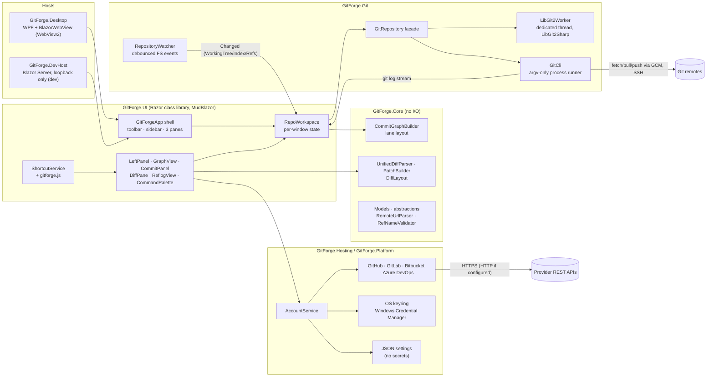

# GitForge Architecture

GitForge is a keyboard-first Git client built with C#/.NET 10, Blazor, and MudBlazor 9. It replaces Sourcetree for teams that need speed on large repositories, multi-account hosting integration, and a security posture suitable for regulated environments.

> **Stack note.** The original brief proposed a Rust UI and a custom GPU diff renderer. Per the project direction, the UI is Blazor + MudBlazor. Rendering speed comes from strict virtualization (only visible rows exist in the DOM) on top of WebView2/Chromium's GPU-composited rendering, not from a custom GPU pipeline.

## 1. Component diagram and data flow



**Read/write split (the key performance and fidelity decision):**

| Path | Engine | Why |
|---|---|---|
| Refs, branches, tags, stashes, submodules, status, commit details, reflog | **libgit2** (LibGit2Sharp) on one dedicated worker thread per repository | In-process, no process-spawn cost; serialized because `Repository` is not thread-safe. |
| History stream | **git CLI** `git log --date-order` streamed record-by-record | Core Git uses the commit-graph file; streaming paints the first rows before a 100k+ commit history finishes. |
| Diffs used for staging | **git CLI** `git diff --no-textconv` | Output is byte-identical to what `git apply` expects, so partial patches round-trip exactly (CRLF preserved). |
| Every write and all network I/O | **git CLI** | Honors hooks, commit signing, LFS filters, `.gitattributes`, credential helpers (Git Credential Manager), SSH agents, proxies, and custom CAs exactly as the command line does. |

**Refresh loop:** `RepositoryWatcher` classifies file-system events (working tree, index, refs, config), debounces them (350 ms), and raises `Changed`. `RepoWorkspace` coalesces overlapping refreshes, re-reads only what changed, and restreams history only when refs change. After any CLI write the libgit2 handle is invalidated so reads never see stale caches.

**Threading:** UI thread never touches git. libgit2 work runs on a per-repository actor thread; CLI work runs on the thread pool; results marshal back through `InvokeAsync`.

## 2. Project structure

```
GitSource/
├─ GitForge.slnx                 Solution (9 projects)
├─ Directory.Build.props         net10.0, nullable, analyzers (latest-recommended)
├─ Directory.Packages.props      Central package versions
├─ global.json                   SDK pin + Microsoft.Testing.Platform runner
├─ src/
│  ├─ GitForge.Core/             Pure domain: Models/, Graph/, Diff/, Rebase/, Hosting/, Validation/, Abstractions/
│  ├─ GitForge.Git/              Cli/GitCli, Engine/ (LibGit2Worker, RepositoryWatcher, Reader, WriteOperations), GitRepository(+Factory)
│  ├─ GitForge.Platform/         Secrets/ (Windows Credential Manager, libsecret), Settings/ (atomic JSON)
│  ├─ GitForge.Hosting/          HostingProviderBase, Providers (GitHub/GitLab/Bitbucket/Azure DevOps), AccountService
│  ├─ GitForge.UI/               GitForgeApp.razor, Components/, Dialogs/, Services/, wwwroot/ (css, js)
│  ├─ GitForge.Desktop/          WPF host (WebView2), native folder picker, app.manifest
│  └─ GitForge.DevHost/          Loopback-only Blazor Server host for UI iteration and automated checks
├─ tests/
│  ├─ GitForge.Core.Tests/       Graph layout, diff parsing, patch building, URL parsing, validation
│  └─ GitForge.Git.Tests/        Integration tests against real temporary repositories
└─ docs/                         ARCHITECTURE.md, ROADMAP.md
```

Dependency rule: `Core` depends on nothing. `Git`, `Platform`, and `Hosting` depend only on `Core`. `UI` composes them. Hosts depend only on `UI`. Adding a macOS/Linux host (Photino or MAUI) requires no changes below `UI`.

## 3. Core API and data models

All types live in `GitForge.Core` (`src/GitForge.Core`).

### Commit nodes and history

```csharp
record CommitInfo(string Sha, IReadOnlyList<string> ParentShas, string AuthorName,
                  string AuthorEmail, DateTimeOffset AuthorDate, string Subject);   // 100k+ kept in memory
record CommitDetails(CommitInfo Summary, string FullMessage, string CommitterName,
                     string CommitterEmail, DateTimeOffset CommitDate, IReadOnlyList<FileChange> Changes);
record HistoryQuery { bool AllRefs; string? StartRef; string? PathFilter; DateTimeOffset? Since, Until; int? MaxCount; }
record RefLabel(string Name, RefKind Kind, bool IsCurrent);                       // badges drawn on rows
```

### Graph layout math

```csharp
enum EdgeKind { PassThrough, IntoNode, OutOfNode }
readonly record struct GraphEdge(EdgeKind Kind, int FromLane, int ToLane, int ColorIndex);
record GraphRow(int RowIndex, CommitInfo Commit, int NodeLane, int NodeColorIndex,
                IReadOnlyList<GraphEdge> Edges, int LaneCount);

sealed class CommitGraphBuilder { GraphRow Add(CommitInfo commit); }              // streaming, O(rows × active lanes)
sealed record GraphGeometry(double LaneWidth = 14, double RowHeight = 26, double NodeRadius = 4)
{ double X(int lane); string PathFor(GraphEdge e, int nodeLane); }               // SVG path data
```

Algorithm: each lane stores the SHA it expects next. A commit lands on the first lane expecting it; other lanes expecting it converge (`IntoNode`). The first parent inherits the lane and color (stable branch colors); a first parent already expected on a lane to the left is joined there (branch point). Extra merge parents reuse an expecting lane or claim the left-most free one. Free lanes are reused; trailing free lanes are trimmed. Each row is self-contained, so the virtualized list renders any row without neighbors. Rows draw top-half edges (`PassThrough`, `IntoNode`) and bottom-half edges (`OutOfNode`) as straight lines or cubic Béziers.

### File status

```csharp
enum FileChangeKind { Unmodified, Added, Modified, Deleted, Renamed, Copied, TypeChanged, Untracked, Ignored, Conflicted }
enum StagingArea { Unstaged, Staged }
record FileStatusEntry(string Path, string? OldPath, FileChangeKind Kind, StagingArea Area);
record WorkingCopyStatus(IReadOnlyList<FileStatusEntry> Staged, Unstaged, Conflicted);
```

### Branch heads and repository snapshot

```csharp
record BranchHead(string Name, string CanonicalName, string? TipSha, bool IsRemote, bool IsCurrent,
                  string? RemoteName, string? UpstreamName, int? Ahead, int? Behind);
record RepositorySnapshot(string WorkingDirectory, string Name, string? HeadBranch, string? HeadSha,
                          bool IsDetached, bool IsBare, RepositoryOperation Operation,
                          IReadOnlyList<BranchHead> LocalBranches, RemoteBranches, IReadOnlyList<TagInfo> Tags,
                          IReadOnlyList<RemoteInfo> Remotes, IReadOnlyList<StashInfo> Stashes,
                          IReadOnlyList<SubmoduleInfo> Submodules);
```

### Diff and partial staging

```csharp
record DiffLine(DiffLineKind Kind, string Text, int? OldLineNumber, int? NewLineNumber, bool NoNewlineAtEnd);
record DiffHunk(int Index, int OldStart, int OldCount, int NewStart, int NewCount, string Section, IReadOnlyList<DiffLine> Lines);
record FileDiff(string? OldPath, string? NewPath, IReadOnlyList<string> HeaderLines, IReadOnlyList<DiffHunk> Hunks, bool IsBinary);
readonly record struct LineRef(int HunkIndex, int LineIndex);
enum PatchAction { Stage, Unstage, Discard }
static class PatchBuilder { string? Build(FileDiff diff, IReadOnlySet<LineRef> selection, PatchAction action); }
```

Forward patches (stage) must match the old side: unselected deletions become context, unselected additions are dropped. Reverse patches (unstage, discard) must match the new side: unselected additions become context, unselected deletions are dropped. Hunk starts are re-based by the running line delta. The result is piped to `git apply [--cached] [--reverse]` on stdin.

### Service interfaces

`IGitRepository` exposes feature areas: `Read` (snapshot, status, history, diffs, reflog, dangling commits), `Index` (stage, unstage, discard, partial patches, commit, conflict resolution), `Branches` (checkout, create, rename, delete, upstream, tags), `Remotes` (fetch, pull, push, prune), `Stashes`, `History` (merge, rebase, cherry-pick, revert, reset, interactive rebase, continue/abort/skip), and `Submodules`. Hosting uses `IHostingProvider` and `IAccountService`; platform services are `ISecretStore` and `ISettingsStore`.

### UI model

The window is three resizable panes. The left panel lists refs (local branches grouped into folders, remotes, pull requests, tags, stashes, submodules). The center shows the commit graph by default; a diff or the reflog opens over it and Esc returns. The right commit panel follows the selection: the **WIP row** (uncommitted changes, drawn as a dashed node directly above HEAD) shows unstaged/staged files and the commit message (summary + description); a commit shows its details and changed files. `RepoWorkspace` owns this selection state (`WipSelected`, `SelectedCommitSha`, `Center`, `OpenDiff`) plus hide/solo ref filters, which re-stream history with an explicit tip list passed to `git log --stdin`.

### Undo

`GitForge.Git.Undo.UndoManager` keeps one undo slot and one redo slot. `UndoableOperations` wraps commit, checkout, branch create/delete, reset, and discard; each records its inverse plus guards (for example, HEAD must still be where the action left it), so undo refuses rather than overwrite newer work. Discard snapshots the affected files' bytes in memory first (up to 64 MB), which also makes deleted untracked files recoverable.

### Submodules

`GitForge.Git.Submodules.SubmoduleAutoUpdater` keeps submodules in step with the superproject. `RepoWorkspace.RunAsync` captures each submodule's recorded commit before an operation; if HEAD moved, it runs `git submodule sync --recursive` and `git submodule update --init --recursive` for submodules whose recorded commit changed or that are new. Submodules with uncommitted changes are skipped and reported. On open, never-initialized submodules are initialized (safe, since nothing is checked out yet); out-of-sync ones get an **Update** prompt rather than a silent reset. The left panel shows the nested tree from `git submodule status --recursive`. The setting `AutoUpdateSubmodules` (default on) disables the automatic path.

## 4. Security posture

- **No telemetry, no cloud dependency.** Network traffic is limited to the user's Git remotes and the hosting APIs they configure. Works fully offline or air-gapped.
- **Secrets.** Hosting tokens are validated, then stored only in the OS keyring (Windows Credential Manager, DPAPI-protected, local-machine persistence, never roamed). Settings JSON contains no secrets. Plaintext buffers are cleared after keyring writes. Platforms without a keyring refuse to store tokens rather than fall back to plaintext.
- **HTTPS by default** for hosting APIs. Cloud providers are fixed to HTTPS. A self-hosted account may be configured with an `http://` URL after an explicit warning and confirmation (the token then travels unencrypted); it is tagged **HTTP** in the UI. Per-request policy (`HostingDefaults.IsRequestAllowed`) permits plain HTTP only for such accounts and only to the configured host and port, so HTTPS accounts are never downgraded and pagination links cannot redirect a token to another host. Schemes other than `http`/`https` are rejected.
- **Git authentication** is delegated to the user's Git configuration (Git Credential Manager, SSH agent, proxies, custom CA settings), so existing enterprise controls apply unchanged.
- **Command execution.** Processes start with an argv list (never a shell). Ref names are validated against `git check-ref-format` rules, revisions starting with `-` are rejected, `--end-of-options` and `--literal-pathspecs` are used where applicable, and large path lists go through stdin (`--pathspec-from-file`). Interactive-rebase todo files accept only hex SHAs.
- **Hooks and signing are honored.** All commits, including reworded commits during interactive rebase, run through `git commit`, so pre-commit/commit-msg hooks and GPG/SSH/X.509 signing policies apply.
- **Desktop hardening.** Release builds disable WebView2 dev tools and browser accelerator keys; the manifest requests `asInvoker` (never elevates).
- **Dev host.** Binds to a loopback IP only and rejects non-loopback `Host` and cross-origin `Origin` headers (blocks DNS rebinding and cross-site WebSocket hijacking). It is for development, not deployment.

## 5. Requirements and tested baseline

- Windows 10 version 1809 (build 17763) or later, or Windows 11, x64, with the WebView2 runtime (built into Windows 11). The desktop host targets `net10.0-windows10.0.17763.0` because the WebView2 SDK's WPF assembly references the Windows SDK projection (`Microsoft.Windows.SDK.NET`).
- .NET 10 SDK to build; .NET 10 runtime to run.
- Git for Windows 2.39 or later on `PATH` (tested with 2.52). GitForge warns in the status bar when Git is missing or too old.
- Key packages: MudBlazor 9.14.0, LibGit2Sharp 0.32.0, Microsoft.AspNetCore.Components.WebView.Wpf 10.0.130, xunit.v3 4.0.3.
